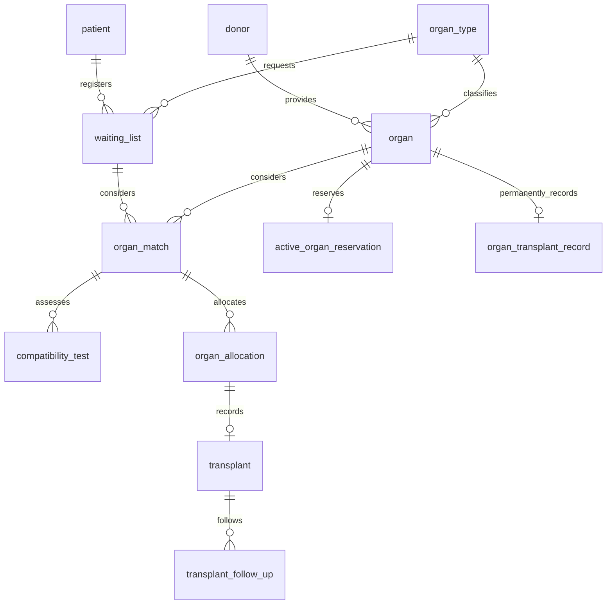

# OrganSync V2 — Faculty Demo Guide

Use fictional educational data only. Compatibility flags are demonstration inputs, not clinically validated medical decisions. MySQL is the source of truth; Atlas stores immutable event/audit history and minimal current-state business projections.

## Preparation

1. Keep the existing `organsync_v2` database and Atlas configuration. Do not run migration, seed, reset or cleanup scripts for the presentation.
2. Start `npm run dev` and open `http://localhost:3000`. The application reads credentials from ignored `.env.local`.
3. For authorized local writes, configure `ORGANSYNC_DEV_WRITES=true` and a privately chosen development token of at least 32 characters. Enable `ORGANSYNC_DEV_DB_DEMO=true` for rollback demonstrations and `ORGANSYNC_DEV_SYNC=true` for the fixed sync controls. Restart after environment changes.
4. Before the timed demo, use `/transplants` → clinician setup to create an explicitly fictional account with your chosen credentials, then sign in. Keep those credentials private. Selecting an active clinician in the compatibility form is a reference; it does not authenticate a clinician. Allocation, transplant and follow-up writes require actual clinician sign-in.
5. Tokens/sessions stay in page memory. Enter the development token again on each module. Navigation away from `/transplants` clears its browser session state; sign in again when returning. Clearing page session is not immediate server-side revocation; sessions expire after one hour.
6. Open tabs for the homepage, `/matching`, `/transplants`, `/database-demo`, `/database-sync`, the existing ER/normalization documents, and MySQL Workbench with read-only queries prepared. Do not display `.env.local`, passwords, token hashes or the Atlas URI on the projector.
7. For background delivery, explicitly enable `ORGANSYNC_SYNC_WORKER_ENABLED=true` and run `npm run sync:worker` in a separate terminal. Alternatively use the explicitly authorized page batch button. Start with that worker stopped if you want to visibly show PENDING → DELIVERED.

Live verification in this phase: 19 tables, 20 triggers, 3 procedures; 43 unit and 54 integration tests passed. All 39 SQL demonstration scenarios passed both in the browser and integration suite. See `PHASE3G-REPORT.md` for the actual evidence and limitations.

## A 14-minute sequence

| Time | Page/evidence | Action and explanation |
|---|---|---|
| 0:00–1:00 | Homepage, ER diagram | State the problem, MySQL authority, 19-table model and three-layer repository/service/API architecture. Explain donor → organ and patient → waiting registration → match. Briefly explain normalization. Dashboard and Reports homepage cards are planned placeholders, not implemented features. |
| 1:00–3:00 | `/donors`, `/patients`, `/organs` | Register one clearly labeled fictional donor and patient with valid birth dates and centre. Add an organ using the donor lookup. Record the generated IDs. New organ is AVAILABLE; its status cannot be set arbitrarily by the CRUD form. Leave optional phone/contact fields empty. |
| 3:00–4:00 | `/waiting-list`, `/matching` | Add an ACTIVE registration with the same organ type. Preview candidates, filter by the new patient and organ IDs, inspect the pair, then confirm Save proposed match. A preview does not write data. |
| 4:00–6:00 | `/matching` | Move PROPOSED → TESTING. Attempt APPROVED without evidence and show the application rejection. Append fictional COMPATIBLE blood-group/HLA/overall evidence using an existing active clinician reference, then approve. Approval does not reserve the organ. |
| 6:00–8:00 | `/transplants` | Sign in with the pre-created fictional clinician. Allocate the approved match. Show RESERVED and stored-procedure execution. Attempt double allocation and show rejection. Release with confirmation; show RELEASED, then allocate again. Record a transplant using a UTC time after the new allocation and not in the future. Show COMPLETED. |
| 8:00–9:00 | `/transplants` follow ups | Add a follow-up for the new transplant. Demonstrate rejection for a date before the transplant, then save a valid date/status. Show clinician attribution and append-only history. |
| 9:00–11:00 | `/database-demo` | Enter the development token, inspect live objects, authorize rollback. Run different-organ-type rejection and same-type acceptance. Show exact trigger, BEFORE INSERT timing, MySQL 1644/45000, before/after state and verified rollback. Show one valid procedure scenario and an immutable follow-up rejection if time permits. The complete 39-row matrix was verified in advance. |
| 11:00–12:00 | MySQL Workbench / SQL files | Run the prepared read-only JOIN, demand CTE and EXPLAIN examples below. Explain foreign keys, CHECK/unique constraints, row locks, caller-owned transactions and atomic audit/outbox writes. Do not run whole migration files. |
| 12:00–13:00 | `/database-sync` | Show actual Atlas Connected, queued committed events, then authorize a bounded sync batch. Refresh until eligible events are delivered. Show sync_events, recent sanitized audit history, attempt counts and historical retry errors. Mention majority acknowledgement and idempotent IDs. |
| 13:00–14:00 | Final evidence | Show completed journey, zero active reservation for its transplanted organ, one permanent organ-transplant mapping, passing tests and unchanged original-record hashes. Explain development-only security, eventual consistency and educational medical limits. |

For a 10–12 minute version, inspect the retained browser journey below instead of creating another complete set of records; still execute fresh rollback trigger/procedure scenarios and a new fixed sync metadata demonstration. Never reset data to rehearse.

## Retained rehearsal journey

| Entity | Verified ID/state |
|---|---|
| Fictional donor | 382 — `Fictional Phase3G Donor 20261102` |
| Fictional patient | 728 — `Fictional Phase3G Patient 20261102` |
| Organ / waiting registration / match | 742 TRANSPLANTED / 778 COMPLETED / 391 APPROVED |
| Allocations | 190 RELEASED, 191 COMPLETED |
| Compatibility evidence | Test 226, all three results COMPATIBLE; active fictional clinician 358 |
| Transplant / follow-up | 103 SUCCESSFUL / follow-up 35, recorded_by 358 |

This journey is already complete. It cannot be allocated or transplanted again. Use new fictional records for a live creation demo. Do not edit/delete the retained history or original demo records.

## ER model and normalization talking points

The authoritative schema is `database/migrations/001_schema.sql`, plus the actually applied additive integrity objects. Existing detailed diagrams are in `docs/04-er-diagram.md`; normalization is explained in `docs/05-normalization.md`.



- 1NF: individual entity rows and atomic fields; assessments and follow-ups are separate rows, not repeating columns.
- 2NF: attributes depend on the complete candidate key. Explain candidate keys as well as surrogate primary keys; an AUTO_INCREMENT key alone does not prove normalization.
- 3NF target: donor details live in donor; organ names in organ_type; centre details in transplant_centre. `organ_allocation` references a match instead of copying patient and donor profiles.
- A match can have multiple allocations over time because release is supported. A unique transplant allocation prevents two transplants for one allocation. A permanent organ mapping prevents reuse across different allocations.
- `active_organ_reservation` and `organ_transplant_record` are deliberate integrity mappings with unique keys. `audit_log` and `sync_outbox` are supporting metadata, not duplicated business records.
- The 19 tables include medical_record, app_user, app_session, audit_log, sync_outbox and schema_migration. Not every table has a standalone CRUD page. Atlas projections are intentionally denormalized secondary history and do not replace the normalized source.

## Actual read-only SQL examples

These are implemented examples from `database/queries/`; all 14 SELECT/CTE examples in joins, ctes, aggregations and subqueries executed successfully during Phase 3G. Some queries legitimately return zero rows.

JOIN from `joins.sql`:

```sql
SELECT o.organ_id, d.full_name AS donor_name, ot.organ_name, o.organ_status
FROM organ o
INNER JOIN donor d ON o.donor_id = d.donor_id
INNER JOIN organ_type ot ON o.organ_type_id = ot.organ_type_id;
```

CTE from `ctes.sql`:

```sql
WITH organ_demand AS (
  SELECT organ_type_id, COUNT(*) AS waiting_count
  FROM waiting_list WHERE status = 'ACTIVE'
  GROUP BY organ_type_id
)
SELECT ot.organ_name, od.waiting_count
FROM organ_demand od
JOIN organ_type ot ON od.organ_type_id = ot.organ_type_id;
```

Index example from `003_indexes.sql` (run only the EXPLAIN, not the migration):

```sql
EXPLAIN SELECT organ_id, organ_type_id, organ_status
FROM organ WHERE organ_status = 'AVAILABLE' AND organ_type_id = 1;
SHOW INDEX FROM organ;
```

The actual observed plan selected `idx_organ_status_type`, access type `ref`, estimated rows 2, with `Using where; Using index`. Explain that estimates/plans can change with data and statistics. Do not drop indexes or claim a timed benchmark. Live integrity indexes also include `uq_match_pair`, `uq_approved_organ`, `uq_approved_waiting` and `uq_active_waiting_registration`.

Inspect live objects without applying SQL:

```sql
SELECT TRIGGER_NAME, EVENT_OBJECT_TABLE, ACTION_TIMING, EVENT_MANIPULATION
FROM information_schema.TRIGGERS
WHERE TRIGGER_SCHEMA = 'organsync_v2' ORDER BY TRIGGER_NAME;
SELECT ROUTINE_NAME FROM information_schema.ROUTINES
WHERE ROUTINE_SCHEMA = 'organsync_v2' AND ROUTINE_TYPE = 'PROCEDURE';
SELECT status, COUNT(*) AS events FROM sync_outbox GROUP BY status;
SELECT organ_id, allocation_id FROM active_organ_reservation WHERE organ_id = 742;
SELECT organ_id, transplant_id FROM organ_transplant_record WHERE organ_id = 742;
```

For rehearsal organ 742, the last two queries show zero active reservations and exactly one permanent mapping to transplant 103.

## Transactions, triggers and procedures

Live procedures are `sp_allocate_organ_tx`, `sp_release_allocation_tx` and `sp_record_transplant_tx`. The legacy names in `006_procedures.sql` are source history, not the live transaction-safe entry points. Do not execute that file: it contains DROP/CREATE and internal transaction control. The existing transaction-demo file also contains a COMMIT example; do not run it wholesale against preserved records.

The service starts a transaction, locks the relevant rows, validates an active authenticated clinician and compatible evidence, creates `SAVEPOINT organsync_phase3e_call`, and calls the appropriate `_tx` routine. The routine consumes that hand-off savepoint before business writes. The service commits or rolls back the entire operation, including its audit and outbox rows. The routine never commits independently.

Actual mysql2 parameterized CALL templates, shown on `/database-demo`:

```sql
CALL sp_allocate_organ_tx(?, ?);
CALL sp_release_allocation_tx(?, ?);
CALL sp_record_transplant_tx(?, ?, ?, 'UNKNOWN', 'Fictional viva transplant', ?);
```

Question marks are bound fixture IDs/timestamps/actor IDs supplied by the application; these templates are not standalone Workbench commands. Use the page's isolated fixture runner for safe execution. Successful procedure demos are rolled back too.

Trigger example: `trg_match_validate_insert`, BEFORE INSERT on `organ_match`, rejects different organ types with exact message **Organ type does not match waiting list**, MySQL `ER_SIGNAL_EXCEPTION`, errno 1644, SQLSTATE 45000. The same-type positive control is accepted. No frontend/service validation intercepts the fixed SQL attempt. All 20 current triggers are BEFORE triggers; do not describe invented AFTER triggers.

Distinguish enforcement: an application validation message is not a trigger error; a named CHECK/unique violation is a constraint; an error raised by `_tx` is procedure enforcement. The page reports the exact object and verifies the real MySQL outcome. Append-only DELETE guards deliberately have no successful DELETE case; valid INSERT is their positive control.

## MySQL–Atlas explanation

MySQL business changes and outbox/audit entries commit atomically. The worker uses a separate transaction, `FOR UPDATE SKIP LOCKED`, stable source/event IDs, immutable `$setOnInsert` upserts, majority confirmation and read-back verification. Only then does it commit DELIVERED. A crash after the Atlas write can replay safely without duplicate documents. An Atlas outage leaves producer commits intact and records FAILED with capped exponential retry backoff.

`sync_events` contains sanitized event metadata; `audit_history` contains independently identified sanitized entity audits. Auth identity/session payloads are redacted and actor IDs are omitted. There is no MongoDB-to-MySQL business write path. Collections are eventually consistent, and event ordering is not a business state machine.

The error list is historical. Current FAILED count may be zero even when a recovered event has an earlier failed attempt. The outage test uses the real driver against an unreachable test endpoint; the partial-write test injects a failure after a real Atlas write. No TLS verification or Atlas firewall rule is disabled for the demo.

## Readiness boundaries

This is an academic development demonstration. Production writes remain blocked; broad authentication/RBAC, production deployment hardening, monitoring and distributed error storage are outside this phase. Matching flags are not medically validated. Use existing record IDs only for inspection and use fresh labeled records for any new committed workflow. Run rollback SQL demonstrations for repeatable database enforcement evidence.

## Verified Phase 3F business-collection extension

This section extends the earlier event/audit demonstration after successful implementation and live verification. The original Phase 3G rehearsal journey and its IDs remain intact.

Atlas `organsync_v2_logs` now has twelve approved business collections: donors, patients, organs, waiting_list, medical_records, matches, compatibility_tests, organ_allocations, transplants, transplant_follow_ups, transplant_centres and organ_types. `projection_sync_state` stores internal checkpoints. Existing sync_events and audit_history remain immutable history.

The initial approved backfill copied 39 source records. Subsequent fictional tests increased the verified current total to 60 active business documents, plus four donor tombstones. medical_records is still empty because MySQL medical_record has zero rows. Do not fabricate data to make that collection look populated. Current counts can increase with later authorized demonstrations; the recorded initial backfill count remains 39.

For a future session, keep the projection feature enabled (`ORGANSYNC_BUSINESS_PROJECTIONS=true`) and run the independent worker:

```powershell
$env:ORGANSYNC_SYNC_WORKER_ENABLED='true'
npm run sync:worker
```

Reconciliation can run in another terminal using `npm run sync:reconcile -- --watch`, or explicitly as one pass with `npm run sync:reconcile`. It catches changes that bypass application events. This is periodic reconciliation, not binlog CDC. Do not run free-running workers during integration suites that inspect their own events.

### Use the final two minutes of the presentation

| Time | Action / actual evidence |
|---|---|
| 12:00–12:30 | Open `/database-sync`. Show all twelve MySQL source/Atlas active counts, separate tombstones, last-refresh times and completed backfill/reconciliation. Explain why raw Atlas donor count includes deletion markers while the source count does not. |
| 12:30–13:30 | Open a newly created fictional donor, or inspect retained browser example 514. With the worker running, change its centre through the website and refresh Atlas. The same deterministic document updates automatically. Actual extension verification used create event 581 and update event 582; no manual sync batch was used. Prefer a fresh fictional donor when preserving the exact recorded rehearsal state. |
| 13:30–14:00 | Show approved `data` fields only, a tombstone and the event/audit history. Explain fenced claims, current-source reads, retry recovery, eventual consistency and MySQL authority. No password, clinical note, DOB, name or blood group appears in these business documents. |

In Atlas, open the project’s Data Explorer, choose Cluster0 and database organsync_v2_logs, then select a collection. Official instructions: [view collections](https://www.mongodb.com/docs/atlas/atlas-ui/collections/) and [apply query filters](https://www.mongodb.com/docs/atlas/atlas-ui/query/filter/).

For the retained donor example, use this read-only Filter:

```json
{ "_id": "organsync-v2:organsync_v2:donor:514" }
```

Its approved business data was verified as `{"donor_id":"514","centre_id":"2"}` after the website update. The name and clinical/person attributes remain only in MySQL. `_sync.generation` is a fencing counter, not a MySQL row version; `last_event_id` can be null after reconciliation and must not be used as a global ordering clock.

For current records:

```json
{ "source": "organsync_v2", "_sync.state": "ready", "_sync.deleted": false }
```

For retained deletion evidence, select donors and filter:

```json
{ "source": "organsync_v2", "_sync.deleted": true }
```

Only disposable fictional extension-test donors were deleted. Their business data is null and their identity remains as a tombstone. Original records and all original event/audit documents were fingerprint-verified unchanged. Do not delete or edit Atlas documents to demonstrate business changes.

Allocation/release events now refresh the related organ and waiting registration as well as the allocation. Transplant events refresh transplant, allocation, organ and waiting registration. The existing transaction-safe procedures and integrity triggers remain unchanged. An old notification refreshes committed current state rather than applying an old clinical snapshot; an expired writer cannot overwrite a newer fenced refresh.

See `PHASE3F-EXTENSION-REPORT.md` for the exact mapping, actual counts, preserved-record evidence, 47 unit/65 integration results, browser evidence, operation commands and limitations. The existing 39-scenario database page passed again in both integration tests and the browser.
