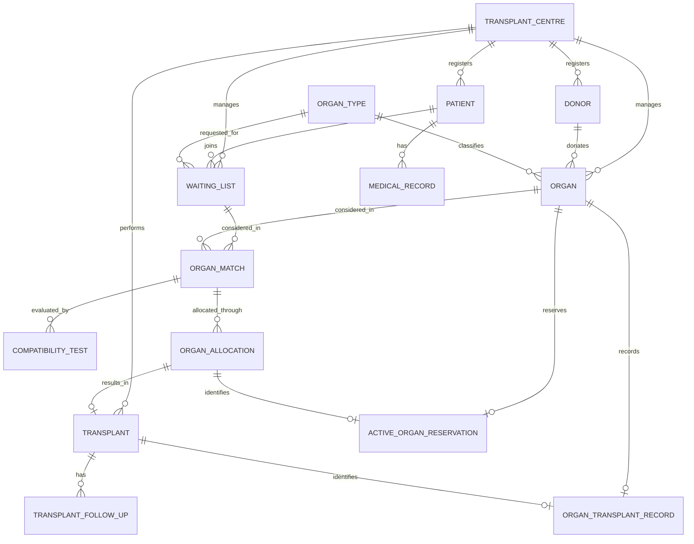
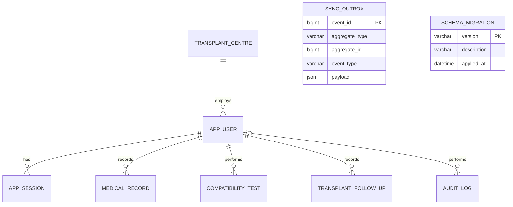

# OrganSync V2 — ER Diagram

## 1. Overview

The OrganSync V2 database contains **19 relational tables**. The ER diagram represents the relationships between donors, patients, organs, waiting lists, matches, allocations, and transplants.

## 2. Core ER Diagram

## 3. Supporting Tables

The following tables support authentication, auditing, and synchronization.

## 4. Important Relationships

- One donor can provide multiple organs.
- One patient can have multiple waiting-list registrations for different organ types.
- Each match connects one organ to one waiting-list registration.
- One match can have multiple compatibility assessments.
- One allocation can result in at most one transplant.
- Each organ can have at most one active reservation.
- Each organ can have at most one permanent transplant record.

## 5. Design Notes

- Foreign keys maintain referential integrity.
- The schema is designed to follow 3NF.
- `active_organ_reservation` prevents concurrent active reservations.
- `organ_transplant_record` prevents duplicate transplantation.
- `sync_outbox` supports asynchronous synchronization with MongoDB Atlas.
- Full column definitions and constraints are implemented in the SQL migration files.
