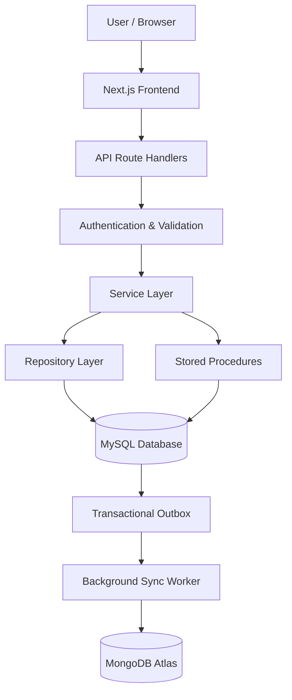

# OrganSync V2 — System Architecture

## 1. Overview

OrganSync V2 uses a database-first, three-layer architecture:

- **Frontend:** Next.js and React
- **Backend:** Next.js API Route Handlers
- **Databases:** MySQL 8.x (primary) and MongoDB Atlas (secondary)

MySQL manages all transactional records. MongoDB stores selected synchronized data and audit events.

## 2. Architecture Diagram



## 3. Component Responsibilities

| Component | Responsibility |
|---|---|
| Frontend | Forms, dashboards, tables, and reports |
| API Routes | Handle HTTP requests and responses |
| Authentication | Verify user identity and permissions |
| Service Layer | Apply application business logic |
| Repository Layer | Execute parameterized SQL queries |
| MySQL | Store relational data and enforce constraints |
| Stored Procedures | Execute critical database transactions |
| Sync Worker | Process outbox events and handle retries |
| MongoDB Atlas | Store approved document projections and audit events |

## 4. Database Architecture

### MySQL — Primary Database

Stores donor, patient, organ, waiting-list, compatibility, allocation, transplant, user, and audit information.

It provides:

- Primary and foreign keys
- Normalized relational tables
- Views, triggers, and stored procedures
- ACID transactions
- SQL reporting

### MongoDB Atlas — Secondary Database

Stores selected document projections and audit events.

MySQL remains the source of truth. MongoDB synchronization is eventually consistent.

## 5. Example Workflow

**Organ Allocation**

1. A coordinator selects an approved match.
2. The frontend sends a request to the backend.
3. The backend validates authentication and permissions.
4. A MySQL stored procedure validates and reserves the organ.
5. MySQL commits the allocation and synchronization event together.
6. The worker processes the event and updates MongoDB Atlas.
7. The frontend displays the updated allocation status.

If the MySQL transaction fails, all its changes are rolled back.

## 6. Project Structure

```text
organsync-v2/
├── docs/
├── database/
│   ├── migrations/
│   ├── queries/
│   └── seeds/
├── src/
│   ├── app/
│   │   ├── api/
│   │   ├── dashboard/
│   │   ├── donors/
│   │   ├── patients/
│   │   ├── organs/
│   │   ├── waiting-list/
│   │   ├── matching/
│   │   ├── transplants/
│   │   └── reports/
│   ├── components/
│   └── lib/
│       ├── db/
│       ├── repositories/
│       ├── services/
│       ├── auth/
│       └── sync/
├── scripts/
├── tests/
└── README.md
```

## 7. Security and Reliability

- Passwords are securely hashed.
- API routes enforce role-based authorization.
- SQL queries use parameterized statements.
- Critical workflows use MySQL transactions.
- The outbox worker retries failed synchronization events.
- MongoDB excludes authentication secrets and unnecessary personal information.
- Only fictional data is used for the educational demonstration.
